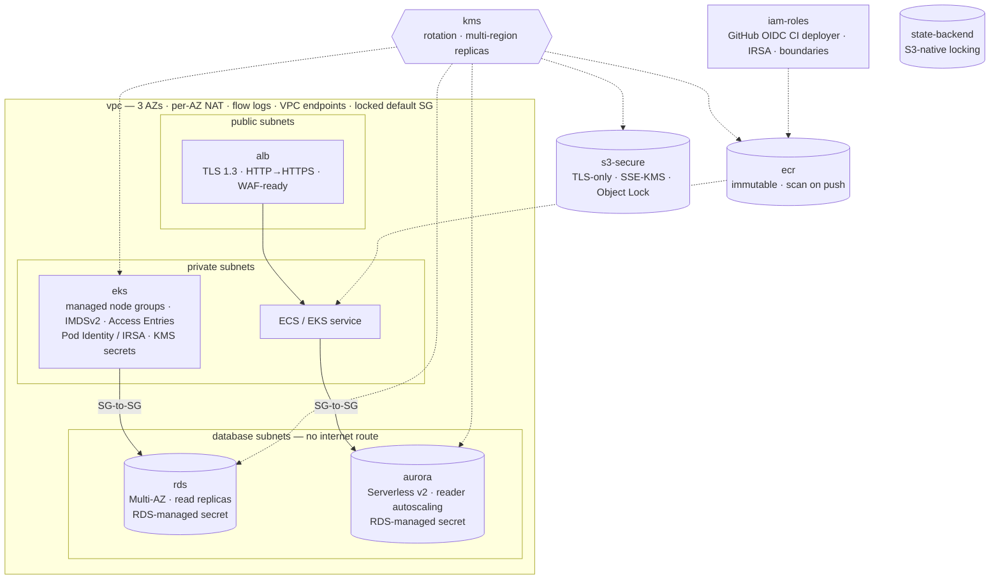

# terraform-aws-blueprint

**Production-grade Terraform modules for AWS infrastructure.**

[](https://www.terraform.io/)
[](https://registry.terraform.io/providers/hashicorp/aws/latest)
[](LICENSE)
[](https://github.com/kirilurbonas/terraform-aws-blueprint/actions/workflows/terraform-validate.yml)
[](https://github.com/kirilurbonas/terraform-aws-blueprint/releases)

An opinionated library of Terraform modules that codify what a platform team
reaches for on day one in AWS — networking, Kubernetes, relational databases,
load balancing, image delivery, encryption, IAM, and remote state — with the
security decisions already made. Every module is independently consumable and
follows the same contract: validated inputs, consistent tagging, production
defaults, no hidden coupling between modules.

What sets it apart is how the claims are checked. Every example is **planned
for real on every pull request** (against a local AWS API emulator, so no
account is involved) and the resulting plan must satisfy a set of
[security policies](policy/) — no admin ports open to the internet,
encryption everywhere, IMDSv2, TLS 1.3, no wildcard IAM, scoped OIDC trust,
the tagging contract. See [Verification](#verification).

## Architecture

The two application-shaped examples, composed only from this library:



`full-stack` is the EKS + RDS + S3 path; `web-app` is the ALB + Aurora + ECR +
GitHub-OIDC path. `state-backend` is bootstrapped once and backs every other
stack.

## Quick start

```hcl
module "vpc" {
  source = "github.com/kirilurbonas/terraform-aws-blueprint//modules/vpc?ref=v0.5.0"

  name_prefix        = "platform"
  environment        = "prod"
  project            = "blueprint"
  vpc_cidr           = "10.20.0.0/16"
  availability_zones = ["us-east-1a", "us-east-1b", "us-east-1c"]

  enable_database_subnets       = true
  manage_default_security_group = true
}
```

Full compositions: [`examples/web-app`](examples/web-app/) and
[`examples/full-stack`](examples/full-stack/).

## Modules

| Module | Purpose |
|--------|---------|
| [`vpc`](modules/vpc/) | Multi-AZ VPC with public / private / optional **isolated database** tiers, configurable subnet sizing, NAT (single or per-AZ), rule-less default security group, flow logs to S3 (SSE-S3 or KMS) or CloudWatch Logs, S3 gateway + interface endpoints with optional endpoint policies. |
| [`eks`](modules/eks/) | EKS control plane + **multiple managed node groups** (ON_DEMAND / SPOT), **launch templates with IMDSv2 required**, **managed add-ons**, **Access Entries** (no `aws-auth`), **Pod Identity** and/or IRSA, KMS envelope encryption, upgrade policy, full control-plane logging. |
| [`rds`](modules/rds/) | Multi-AZ RDS (Postgres / MySQL), KMS-encrypted, **RDS-managed master secret** (opt-in), Performance Insights, Enhanced Monitoring, read replicas, managed log groups, CloudWatch alarms, blue/green updates. |
| [`aurora`](modules/aurora/) | Aurora PostgreSQL / MySQL cluster: always-encrypted, RDS-managed master secret, instances as a map, **Serverless v2**, reader autoscaling, IAM auth, managed log groups and parameter group, Database Insights, alarms. |
| [`alb`](modules/alb/) | Application Load Balancer: HTTPS with a **TLS 1.3 policy enforced**, HTTP that can only redirect, invalid headers dropped, strictest desync mitigation, target groups and host/path rules as maps, access/connection logs, WAFv2. |
| [`ecr`](modules/ecr/) | ECR repositories: **immutable tags**, scan on push, KMS encryption, lifecycle policy, scoped cross-account / Lambda pull, optional registry scanning, pull-through cache, and replication. |
| [`iam-roles`](modules/iam-roles/) | Platform IAM roles: EKS cluster, EKS node, IRSA, and a CI deployer trusted via **GitHub Actions OIDC** (repo + branch / environment scoped) or cross-account; permissions boundaries everywhere. |
| [`s3-secure`](modules/s3-secure/) | S3 bucket with public access blocked, ACLs disabled, encryption + versioning + lifecycle + TLS-only policy + encryption-header enforcement, Object Lock, replication, EventBridge, Intelligent-Tiering. |
| [`kms`](modules/kms/) | Customer-managed KMS key with rotation, alias, explicit key policy, and **multi-region replicas** without provider aliases. |
| [`state-backend`](modules/state-backend/) | Remote-state bucket with **S3-native locking** (or DynamoDB), access logging, and DR replication. Emits a ready-to-paste backend block. |

## Examples

| Example | What it shows | Est. cost (us-east-1) |
|---------|---------------|-----------------------|
| [`simple-vpc`](examples/simple-vpc/) | Minimal `vpc` call. | ~$32/mo |
| [`eks-cluster`](examples/eks-cluster/) | `vpc` + `eks` wired together; private endpoint, default node group, managed add-ons, VPC endpoints. | ~$320/mo |
| [`full-stack`](examples/full-stack/) | `vpc` + `eks` + `rds` + `s3-secure` + `kms` + IRSA — two node groups, database tier, read replica, RDS-managed secret. | ~$1060/mo |
| [`web-app`](examples/web-app/) | `vpc` + `alb` + `aurora` + `ecr` + `kms` + GitHub-OIDC CI role — the edge, data, and delivery layers for a containerised service, with chained security groups. | ~$300/mo |
| [`prod-overrides`](examples/prod-overrides/) | `override.tf` pattern for bolting `prevent_destroy = true` onto module-managed stateful resources. | ~$32/mo |

## Design principles

- **Least privilege by default.** No role gets `AdministratorAccess` from this
  library. IAM is module-scoped, AWS-managed policies are used only where AWS
  expects them, and IRSA is the canonical pattern for workload credentials.
  The CI deployer role takes allow-only statement lists from the caller — there
  are no wildcard escape hatches.
- **Encryption everywhere.** RDS storage, EKS secrets (KMS envelope), S3
  (SSE-S3 or SSE-KMS), EBS volumes on EKS nodes — all encrypted by default.
  S3 buckets ship with a bucket policy denying plaintext (HTTP) traffic and
  unencrypted uploads. The `kms` module makes it trivial to bring a
  customer-managed key with rotation and a curated key policy.
- **IMDSv2 required.** Every EKS node runs under a launch template that sets
  `http_tokens = "required"`. No more long-tail SSRF-to-credential-theft
  footguns.
- **Multi-AZ defaults.** Subnets, NAT, RDS, and EKS node groups all spread
  across AZs unless the caller explicitly opts out for cost reasons. The `vpc`
  module exposes a `single | per_az` NAT switch so the trade-off is explicit.
- **No legacy patterns.** EKS uses **Access Entries** (the IAM-API replacement
  for `aws-auth`, GA 2023) — no in-cluster bootstrap, no `kubernetes` provider
  required just to apply the module. Security groups use the v5
  `aws_vpc_security_group_*_rule` resources, not the deprecated
  `aws_security_group_rule`.
- **Tagging is a contract.** Every resource gets `Name`, `Environment`,
  `ManagedBy=Terraform`, `Project`, and a `Module` tag, merged with any
  caller-supplied tags via a shared `locals.common_tags` map. The pattern is
  identical across every module.
- **Consistent naming.** Resources follow
  `${name_prefix}-${environment}-${resource}` unless an AWS naming constraint
  forces otherwise.
- **Validated inputs.** Every variable has a type and description; CIDRs,
  enums, ranges, and identifier formats use `validation` blocks so bad input
  fails at plan time, not apply time.
- **Stateful resources are protected.** RDS ships with `deletion_protection`
  on and takes a deterministic final snapshot in prod; the master secret is
  kept in a 30-day Secrets Manager recovery window. S3 enables versioning.
  EKS node groups `ignore_changes` on `desired_size` so Cluster Autoscaler /
  Karpenter can own runtime sizing without Terraform fighting back. For hard
  `lifecycle.prevent_destroy = true` see
  [`examples/prod-overrides`](examples/prod-overrides/).
- **No hidden coupling.** Modules don't reach into each other. Wiring (e.g.
  RDS ingress from EKS nodes) happens in the root module using outputs — see
  the `full-stack` example.

## Requirements

| Tool / provider | Version |
|-----------------|---------|
| Terraform | `>= 1.5.0` (`terraform test` + `optional()` defaults) |
| AWS provider | `>= 6.0, < 7.0` |
| Random provider (only for `rds`) | `>= 3.5, < 4.0` |

The AWS provider floor is `6.0` because `vpc` and `state-backend` read
`data.aws_region.current.region`, which the provider only exposes from v6
onward. The upper bound is deliberate: a future v7 will not silently break
consumers pinned to this library. CI validates every module against the floor
as well as the latest allowed version, so the constraint stays true.

Region and credentials come from your AWS provider config — no module
hardcodes a region or account ID.

## Repository layout

```
.
├── modules/
│   ├── vpc/                 # multi-AZ networking + VPC endpoints
│   ├── eks/                 # EKS w/ multi-NG, addons, access entries, IMDSv2
│   ├── rds/                 # Postgres/MySQL, Secrets Manager, read replicas
│   ├── iam-roles/           # cluster / node / IRSA / CI deployer
│   ├── s3-secure/           # secure-by-default bucket
│   ├── kms/                 # CMK with explicit policy, multi-region replicas
│   ├── state-backend/       # remote-state bucket, S3-native locking
│   ├── alb/                 # HTTPS-only application load balancer
│   ├── aurora/              # Aurora Postgres/MySQL, Serverless v2
│   └── ecr/                 # immutable, scanned image repositories
├── examples/
│   ├── simple-vpc/          # sandbox VPC
│   ├── eks-cluster/         # VPC + EKS
│   ├── full-stack/          # VPC + EKS + RDS + S3 + KMS + IRSA
│   ├── web-app/             # VPC + ALB + Aurora + ECR + GitHub OIDC
│   └── prod-overrides/      # override.tf pattern for prevent_destroy
├── policy/                  # Conftest rules evaluated on example plan JSON
├── scripts/
│   └── policy-check.sh      # plan examples against Moto, run conftest
├── docs/
│   ├── adr/                 # architecture decision records
│   └── upgrading.md         # opt-in flags and the 1.0 default flips
├── .github/
│   ├── workflows/terraform-validate.yml
│   ├── workflows/release-drafter.yml
│   ├── release-drafter.yml
│   ├── dependabot.yml
│   ├── CODEOWNERS
│   ├── pull_request_template.md
│   └── ISSUE_TEMPLATE/
├── .pre-commit-config.yaml
├── .terraform-docs.yml
├── .tflint.hcl
├── .trivyignore.yaml
├── .gitignore
├── Makefile
├── ROADMAP.md
├── CHANGELOG.md
├── CONTRIBUTING.md
├── SECURITY.md
├── LICENSE
└── README.md
```

## Local development

You need `terraform`, `tflint`, `terraform-docs`, and `trivy` on `PATH`, plus
`conftest` and Moto (`pipx install 'moto[server]'`) for `make policy`.
Install the [pre-commit](https://pre-commit.com/) hooks once:

```bash
pre-commit install
```

The hooks run `terraform fmt`, `terraform validate`, `terraform_docs`,
`tflint`, and `trivy` on every commit.

Everything else goes through the [`Makefile`](Makefile), which CI calls too —
so a green `make all` locally means a green pipeline:

```bash
make help            # list targets
make fmt             # canonical formatting
make validate        # init + validate every module and example
make validate-floor  # re-validate modules against the declared provider floor
make lint            # tflint, shared rule set from .tflint.hcl
make test            # plan-only module tests against mock_provider
make docs-check      # fail if terraform-docs output is stale
make security        # trivy, gating on HIGH/CRITICAL
make policy          # plan every example, enforce policy/ on the plan JSON
make all             # all of the above
```

To run one module's tests directly:

```bash
cd modules/<name>
terraform init -backend=false
terraform test
```

CI runs the same checks on every PR and posts a sticky summary comment:
[`.github/workflows/terraform-validate.yml`](.github/workflows/terraform-validate.yml).
Every Trivy finding is uploaded to GitHub code scanning; HIGH and CRITICAL gate
the build. Suppressions live in [`.trivyignore.yaml`](.trivyignore.yaml), each
with a written justification — and anything that is a real gap rather than a
deliberate choice carries an expiry date so it cannot be forgotten.

## Verification

Every pull request has to clear the same gates, and `make all` runs them
locally:

| Gate | What it proves |
|------|----------------|
| `terraform test` | Each module plans what it claims for every documented input combination, and every `validation` block rejects what it should. Plan-only against `mock_provider` — see [ADR 0002](docs/adr/0002-plan-only-tests.md). |
| Provider-floor validate | Every module still validates against the oldest AWS provider its constraint admits. |
| Policy (Conftest) | Each example is planned for real — against [Moto](https://github.com/getmoto/moto), no AWS account — and the plan JSON must satisfy [`policy/`](policy/): no admin ports open to the internet, encryption at rest everywhere, IMDSv2, TLS 1.3 on ALBs, no `Action: "*"`, no unscoped web-identity trust, the tagging contract. See [ADR 0003](docs/adr/0003-policy-on-plan-json.md). |
| Trivy | Static misconfiguration scan; HIGH/CRITICAL gate the build, every finding goes to code scanning. |
| tflint | Terraform + AWS rulesets at `preset = "all"`. |
| terraform-docs drift | Every README's inputs/outputs table matches the code. |

Design decisions behind the library live in [`docs/adr/`](docs/adr/).
Upgrade notes and the list of defaults that change at `v1.0.0` are in
[`docs/upgrading.md`](docs/upgrading.md).

## Roadmap

See [`ROADMAP.md`](ROADMAP.md) for what each upcoming release carries, which
breaking changes are staged behind opt-in flags, and what has been explicitly
ruled out.

## Contributing

See [`CONTRIBUTING.md`](CONTRIBUTING.md). For security issues see
[`SECURITY.md`](SECURITY.md) — please don't file them publicly.

## License

[MIT](LICENSE).
