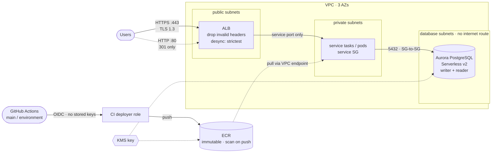

# example: web-app

The infrastructure a containerised web service needs around its compute: an
HTTPS edge, a database, an image registry, and a keyless CI path from GitHub.
Compute is deliberately left out — register ECS tasks or EKS pods (via the AWS
Load Balancer Controller's `TargetGroupBinding`) in the target group this
stack outputs, and attach the service security group to them.



Wiring highlights:

- **Security groups chain, they don't fan out.** The ALB may egress only to the
  service security group on the service port; Aurora accepts connections only
  from the service security group. All of it is expressed with
  `aws_vpc_security_group_*_rule` resources and map inputs with static keys,
  so the stack plans in a single pass even though every ID is computed.
- **Database tier is isolated.** Aurora sits in the VPC's database subnets,
  whose route tables have no internet or NAT route.
- **No passwords in state.** Aurora manages its own master secret, encrypted
  with the stack's KMS key.
- **Keyless CI.** GitHub Actions assumes the deployer role through OIDC. The
  trust policy pins `aud` to `sts.amazonaws.com` and `sub` to one repository's
  `main` branch and matching GitHub environment; the role can push to the one
  ECR repository and nothing else.
- **No open egress from the service.** ECR API, ECR DKR, CloudWatch Logs, and
  Secrets Manager interface endpoints plus the S3 gateway endpoint carry
  image pulls, logs, and secret reads, so the service security group allows
  HTTPS only to the VPC CIDR and the S3 prefix list — never `0.0.0.0/0`. Add a
  rule if the service must call third-party APIs through NAT.

## Usage

```bash
cd examples/web-app
terraform init
terraform apply \
  -var domain_name=app.example.org \
  -var github_repository=example-org/web-app
```

The apply waits on `aws_acm_certificate_validation` until ACM issues the
certificate. In another shell, create the records it needs:

```bash
terraform output certificate_validation_records
```

Then point `domain_name` at `alb_dns_name` (Route 53 alias with `alb_zone_id`,
or a CNAME elsewhere).

In the application repository's workflow:

```yaml
permissions:
  id-token: write
  contents: read

jobs:
  push:
    runs-on: ubuntu-latest
    environment: dev            # must match var.environment
    steps:
      - uses: aws-actions/configure-aws-credentials@v4
        with:
          role-to-assume: ${{ vars.CI_ROLE_ARN }}   # terraform output ci_role_arn
          aws-region: us-east-1
      - uses: aws-actions/amazon-ecr-login@v2
      - run: |
          docker build -t "$REPO:$GITHUB_SHA" .
          docker push "$REPO:$GITHUB_SHA"
        env:
          REPO: ${{ vars.ECR_REPOSITORY_URL }}       # terraform output ecr_repository_url
```

Tags are immutable, so push a unique tag per build (the commit SHA) rather
than re-pushing `latest`.

If the account already has a GitHub OIDC provider, pass
`-var create_github_oidc_provider=false -var github_oidc_provider_arn=<arn>`.

## Approximate monthly cost

us-east-1, idle-to-light traffic. Serverless v2 scales with load; these
figures assume it sits near the 0.5 ACU floor.

| Component | Cost |
|-----------|------|
| 3 × NAT gateway | ~$99 |
| ALB | ~$18 + LCUs |
| Aurora Serverless v2, 2 instances at 0.5 ACU | ~$88 + storage/IO |
| 4 interface endpoints × 3 AZs | ~$88 |
| KMS key | $1 |
| ECR, flow logs, CloudWatch | usage-based |
| **Total** | **~$300/mo** before traffic |

For a non-production environment, `nat_gateway_mode = "single"` and dropping
the reader instance bring this to roughly $140/mo.

<!-- BEGIN_TF_DOCS -->
## Requirements

| Name | Version |
| ---- | ------- |
| <a name="requirement_terraform"></a> [terraform](#requirement\_terraform) | >= 1.5.0 |
| <a name="requirement_aws"></a> [aws](#requirement\_aws) | >= 6.0, < 7.0 |

## Providers

| Name | Version |
| ---- | ------- |
| <a name="provider_aws"></a> [aws](#provider\_aws) | >= 6.0, < 7.0 |

## Modules

| Name | Source | Version |
| ---- | ------ | ------- |
| <a name="module_alb"></a> [alb](#module\_alb) | ../../modules/alb | n/a |
| <a name="module_aurora"></a> [aurora](#module\_aurora) | ../../modules/aurora | n/a |
| <a name="module_ci"></a> [ci](#module\_ci) | ../../modules/iam-roles | n/a |
| <a name="module_ecr"></a> [ecr](#module\_ecr) | ../../modules/ecr | n/a |
| <a name="module_kms"></a> [kms](#module\_kms) | ../../modules/kms | n/a |
| <a name="module_vpc"></a> [vpc](#module\_vpc) | ../../modules/vpc | n/a |

## Resources

| Name | Type |
| ---- | ---- |
| [aws_acm_certificate.this](https://registry.terraform.io/providers/hashicorp/aws/latest/docs/resources/acm_certificate) | resource |
| [aws_acm_certificate_validation.this](https://registry.terraform.io/providers/hashicorp/aws/latest/docs/resources/acm_certificate_validation) | resource |
| [aws_security_group.service](https://registry.terraform.io/providers/hashicorp/aws/latest/docs/resources/security_group) | resource |
| [aws_vpc_security_group_egress_rule.service_endpoints](https://registry.terraform.io/providers/hashicorp/aws/latest/docs/resources/vpc_security_group_egress_rule) | resource |
| [aws_vpc_security_group_egress_rule.service_postgres](https://registry.terraform.io/providers/hashicorp/aws/latest/docs/resources/vpc_security_group_egress_rule) | resource |
| [aws_vpc_security_group_egress_rule.service_s3](https://registry.terraform.io/providers/hashicorp/aws/latest/docs/resources/vpc_security_group_egress_rule) | resource |
| [aws_vpc_security_group_ingress_rule.service_from_alb](https://registry.terraform.io/providers/hashicorp/aws/latest/docs/resources/vpc_security_group_ingress_rule) | resource |
| [aws_availability_zones.available](https://registry.terraform.io/providers/hashicorp/aws/latest/docs/data-sources/availability_zones) | data source |

## Inputs

| Name | Description | Type | Default | Required |
| ---- | ----------- | ---- | ------- | :------: |
| <a name="input_create_github_oidc_provider"></a> [create\_github\_oidc\_provider](#input\_create\_github\_oidc\_provider) | Create the account's GitHub Actions OIDC provider. Only one may exist per account: set false and pass github\_oidc\_provider\_arn if it already does. | `bool` | `true` | no |
| <a name="input_domain_name"></a> [domain\_name](#input\_domain\_name) | Hostname the ALB serves. An ACM certificate is requested for it and validated over DNS. | `string` | `"app.example.com"` | no |
| <a name="input_environment"></a> [environment](#input\_environment) | Environment name (dev / staging / prod). Also the GitHub environment the CI role trusts. | `string` | `"dev"` | no |
| <a name="input_github_oidc_provider_arn"></a> [github\_oidc\_provider\_arn](#input\_github\_oidc\_provider\_arn) | Existing token.actions.githubusercontent.com OIDC provider ARN, when create\_github\_oidc\_provider = false. | `string` | `null` | no |
| <a name="input_github_repository"></a> [github\_repository](#input\_github\_repository) | GitHub repository (owner/repo) whose workflows may assume the CI deployer role. | `string` | `"example-org/web-app"` | no |
| <a name="input_project"></a> [project](#input\_project) | Project tag applied to every resource; also the ECR repository namespace. | `string` | `"blueprint"` | no |
| <a name="input_region"></a> [region](#input\_region) | AWS region. | `string` | `"us-east-1"` | no |
| <a name="input_service_port"></a> [service\_port](#input\_service\_port) | Port the service listens on inside its tasks/pods. | `number` | `8080` | no |
| <a name="input_vpc_cidr"></a> [vpc\_cidr](#input\_vpc\_cidr) | VPC CIDR block. | `string` | `"10.40.0.0/16"` | no |

## Outputs

| Name | Description |
| ---- | ----------- |
| <a name="output_alb_dns_name"></a> [alb\_dns\_name](#output\_alb\_dns\_name) | ALB DNS name. Point the domain at it with an alias (Route 53) or CNAME record. |
| <a name="output_alb_zone_id"></a> [alb\_zone\_id](#output\_alb\_zone\_id) | ALB hosted zone ID, for a Route 53 alias record. |
| <a name="output_certificate_validation_records"></a> [certificate\_validation\_records](#output\_certificate\_validation\_records) | DNS records to create so ACM can issue the certificate. |
| <a name="output_ci_role_arn"></a> [ci\_role\_arn](#output\_ci\_role\_arn) | Role for GitHub Actions: aws-actions/configure-aws-credentials role-to-assume. |
| <a name="output_database_endpoint"></a> [database\_endpoint](#output\_database\_endpoint) | Aurora writer endpoint. |
| <a name="output_database_reader_endpoint"></a> [database\_reader\_endpoint](#output\_database\_reader\_endpoint) | Aurora reader endpoint. |
| <a name="output_database_secret_arn"></a> [database\_secret\_arn](#output\_database\_secret\_arn) | RDS-managed Secrets Manager secret holding the master credentials. |
| <a name="output_ecr_repository_url"></a> [ecr\_repository\_url](#output\_ecr\_repository\_url) | Image repository URL to push to. |
| <a name="output_service_security_group_id"></a> [service\_security\_group\_id](#output\_service\_security\_group\_id) | Security group to attach to the service's tasks or pods. |
| <a name="output_target_group_arn"></a> [target\_group\_arn](#output\_target\_group\_arn) | Target group to register the service in (ECS service load\_balancer block, or an EKS TargetGroupBinding). |
<!-- END_TF_DOCS -->
